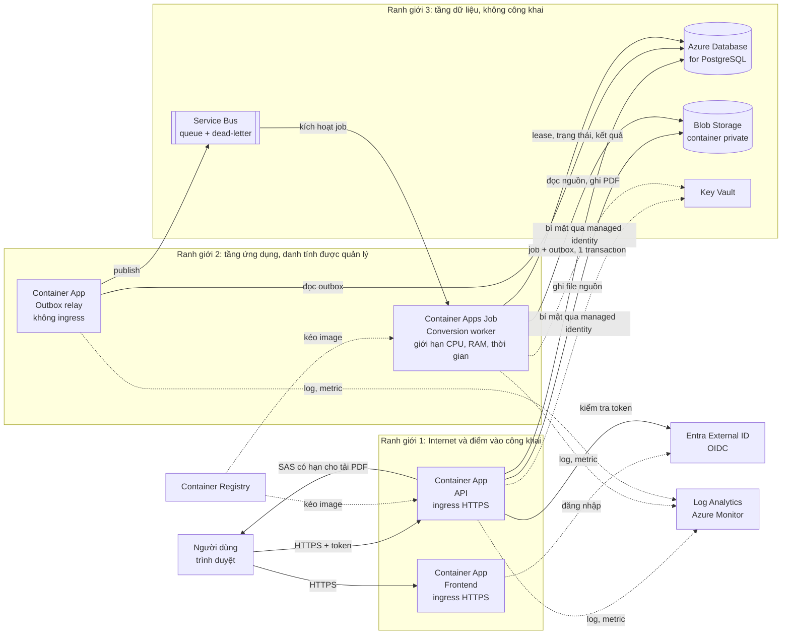

# Kiến trúc triển khai trên Azure (bản nháp)

> Thay cho bản logic trong `docs/architecture.md`. Đề yêu cầu bản **thực tế**: tên dịch vụ, đường mạng, ranh giới tin cậy, miền lỗi; và nhắc "ranh giới cloud không tự động là mạng riêng".
> Chỗ đánh dấu **[Như xác nhận]** là giả định của Muội dựa trên gợi ý của đề, **chưa kiểm tra trên subscription thật**. Cập nhật sau khi Terraform chạy được.

## 1. Sơ đồ dịch vụ, đường mạng và ranh giới tin cậy

## 2. Bảng dịch vụ và lý do chọn

| Thành phần | Dịch vụ Azure | Lý do | Ghi chú |
|---|---|---|---|
| Frontend, API | Container Apps (hoặc App Service) | Đề gợi ý; cùng image với bản Docker cục bộ | Chọn một loại, ghi lý do **[Như xác nhận]** |
| Cơ sở dữ liệu | Azure Database for PostgreSQL | Cùng PostgreSQL với bản cục bộ, migration giữ nguyên | Gói nhỏ nhất, tốn credit nhất |
| Lưu file | Blob Storage | Thay SeaweedFS (S3); cần adapter `Storage` mới | Tắt truy cập công khai |
| Hàng đợi | Service Bus (queue + dead-letter) | Thay RabbitMQ; có giao lại và dead-letter | Cần adapter `Queue` mới |
| Chuyển đổi | Container Apps Jobs | Đề gợi ý; job có giới hạn tài nguyên và thời gian | Cách kích hoạt từ Service Bus **[Như xác nhận]** |
| Đăng nhập | Entra External ID | Đề gợi ý (OIDC) | Làm sau; trước mắt đăng nhập giả |
| Bí mật | Key Vault | Đề yêu cầu | Truy cập bằng managed identity |
| Image | Container Registry | Chứa image `api`, `worker`, `relay`, `frontend` | Gói Basic |
| Giám sát | Log Analytics, Azure Monitor | Dashboard, alert, log theo `job_id` | Xem `observability.md` |

Chưa thêm dịch vụ tuỳ chọn nào (API Management, Front Door, ...). Đề yêu cầu dịch vụ tuỳ chọn phải có lý do kiến trúc.

## 3. Đường mạng và ranh giới tin cậy

| Ranh giới | Thành phần | Ai được vào | Kiểm soát |
|---|---|---|---|
| 1. Công khai | Frontend, API | Internet, chỉ HTTPS | Token OIDC kiểm tra ở API; HTTP bị chuyển hướng hoặc từ chối |
| 2. Ứng dụng | Relay, Job chuyển đổi | Không có ingress công khai | Chỉ nhận lệnh qua queue; danh tính được quản lý (managed identity), không dùng khoá dài hạn |
| 3. Dữ liệu | PostgreSQL, Blob, Service Bus, Key Vault | Chỉ danh tính ứng dụng và đường mạng cần thiết | Blob không công khai; Postgres chỉ chấp nhận kết nối từ tầng ứng dụng |

**Điểm phải quyết định và ghi lại** (đề nói rõ phải "document the selected method"):

| Câu hỏi | Các lựa chọn | Quyết định |
|---|---|---|
| Container Apps kết nối Postgres riêng tư thế nào? | (a) VNet integration + private access cho Postgres; (b) Postgres có public endpoint nhưng chỉ cho phép IP/dịch vụ cần thiết | ___ **[Như]** (a) an toàn hơn, (b) đơn giản và rẻ hơn |
| Blob và Service Bus: private endpoint hay chỉ tắt truy cập công khai + danh tính? | Private endpoint tốn thêm | ___ **[Như]** |
| Tải PDF | SAS URL ngắn hạn do API cấp sau khi kiểm tra quyền | 10 phút (đề xuất) |

## 4. Miền lỗi (failure domains)

| Thành phần | Nếu hỏng | Ảnh hưởng | Cách chịu lỗi |
|---|---|---|---|
| Một worker | Job đang chạy dừng | Một job | Lease hết hạn, job thử lại hoặc `failed` |
| Relay | Event ở lại outbox | Job chậm vào queue | Outbox bền, relay chạy lại sẽ gửi |
| Service Bus | Không giao được message | Không có job mới được xử lý | Job vẫn ở `queued` trong DB; dead-letter cho message lỗi |
| PostgreSQL | Mất trạng thái job | API và worker không ghi tiến độ | Worker thử lại có giới hạn; không ack khi chưa ghi được |
| Blob Storage | Không đọc/ghi file | Upload hoặc chuyển đổi lỗi | Job `failed` kèm `storage_error`, không báo `succeeded` khi chưa có PDF |
| Cả vùng Azure | Toàn hệ thống | Mọi thứ | **Không có dự phòng đa vùng** (ngoài phạm vi và ngân sách); ghi rõ trong báo cáo |

## 5. Việc cần làm

- [ ] Như: xác nhận các điểm đánh dấu **[Như]**, cập nhật bảng quyết định mục 3
- [ ] Như: gửi `terraform plan` hoặc danh sách tài nguyên thật để Muội đối chiếu sơ đồ
- [ ] Muội: thay sơ đồ bằng bản đúng với hạ tầng đã triển khai, xuất ảnh cho báo cáo
